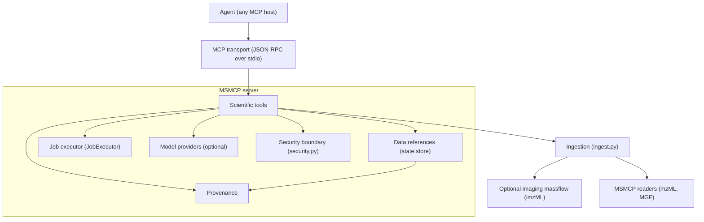

# MSMCP architecture

This document describes what MSMCP is, what it is not, and how the pieces fit
together. It is the reference for deciding whether a change belongs in the
released version, in an optional capability, or outside the project for now.

`1.0.0` is released and its acceptance criteria are met below. `v1.1` is the
next milestone: its criteria are at the end of this document, and its narrative —
why the milestone exists and what is deliberately excluded — is in
[`docs/roadmap.md`](docs/roadmap.md).

## The product in one sentence

MSMCP is a **reliable MCP interface to mass-spectrometry data, spectral
libraries and scientific computation**: an agent can ingest real MS data,
search it against a local spectral library, compute over it, pass large
datasets between operations without pushing them through the conversation, and
get results it can trace back to their inputs.

## Layer diagram



The dependency rule that keeps this tractable: **tools depend on interfaces,
never on mechanisms.** Tools call `JobExecutor`, not `asyncio`. Tools call
`ingest.resolve_source`, not MassFlow. Tools carry `Provenance`, not log
lines. Only `ingest.py` knows which library parses which format.

## Scope

### Deployment posture

MSMCP runs **onsite, offline and self-contained**. It is a single local process
speaking stdio, launched by the MCP host with the user's own credentials. It
makes no network calls, needs no credentials or API keys, and depends on no
hosted service, daemon or database; its test suite is hermetic for the same
reason. This is a design constraint rather than a description of the current
milestone — see *Security and limits*.

### Direction: local MS database connectivity

The forward focus of this repository is **connectivity to mass-spectrometry
databases held on disk**: read a spectral library the user already has, in a
format they already have it in, and let an agent search it. That is what
`search_library` exists to do, and closing that gap is the primary v1.1
deliverable (see *Known limitations*).

The shape is a provider interface, mirroring `SpectralEmbedder` and
`JobExecutor` — the third use of the same pattern:

```python
class LibraryProvider(ABC):
    def describe(self) -> LibraryInfo    # name, format, version, n_spectra, digest
    def iter_spectra(self, chunk_size) -> Iterator[LibrarySpectrum]


def get_library_provider(path, policy) -> LibraryProvider  # registry, like get_embedder
```

`policy` is required, not defaulted: a library cannot be opened without crossing
the same `SecurityPolicy` as an acquisition.

Planned implementations, in order: **MGF** (reusing `mgf.py`), **MSP** (the
NIST text interchange format most libraries ship as), then a local **SQLite**
peak store.  **MSP is implemented** (`msmcp.library`); MGF and SQLite are still
planned.  Each is selected from `search_library`'s `database_file` argument,
and `provenance.SourceRef` records which library, format and version answered a
query — the reproducibility requirement that a hit table be traceable.

Constraints that follow from the offline posture:

* Library files go through the **same** security boundary as acquisitions —
  allowed root, size limit, and no write access.
* MSMCP ships **no library data** and downloads none. Commercial libraries
  (NIST, METLIN, mzCloud) are licensed per seat; the user supplies the file.
* No credentials, no rate limits and no cache layer, because there is no remote
  service to talk to.

### Core capabilities

The table below describes the current core of the server. Two of its entries —
the spectral library reader (`library.py`) and the instrument-class defaults
(`instruments.py`) — are merged to `main` but are **not** in the `1.0.0` tag:
they are the first v1.1 deliverables (see [`docs/roadmap.md`](docs/roadmap.md)).
Everything else is present in the released version.

| Capability | Where | Notes |
|---|---|---|
| Optional imaging ingestion | `massflow_io.py`, `ingest.py` | imzML via lowercase `massflow`; requires the `imaging` extra |
| MSMCP-owned readers | `mzml.py`, `mgf.py` | core mzML/MGF; independent of MassFlow |
| Spectral library reader | `library.py` | `LibraryProvider`; MSP/NIST text libraries, behind the same security boundary as acquisitions (on `main`, unreleased) |
| Core scientific tools | `tools/chem.py`, `tools/similarity.py`, `tools/qc.py`, `tools/io.py`, `tools/chromatograms.py` | exact mass, isotopes, ppm validation, cosine, QC and bounded scan-level TIC/BPC/XIC |
| Spectral scoring contract | `models/scoring.py` | `SpectrumScorer`; classical (in-house, reference implementation) and embedding scorers behind one interface |
| Instrument-class defaults | `instruments.py` | every experimental threshold, its default per instrument class, and the provenance of each default (on `main`, unreleased) |
| Server-side data references | `state/pointers.py`, `state/store.py` | payloads never cross MCP/JSON |
| Provenance / reproducibility | `provenance.py` | structured, immutable, JSON-safe |
| Asynchronous execution | `execution/executor.py`, `tools/search.py` | pluggable; local asyncio implementation |
| Resource and security limits | `security.py`, `state/store.py`, `execution/executor.py` | filesystem root, file size, spectrum count, reference count/bytes, job concurrency |
| Clean static analysis | `pyproject.toml` | ruff + mypy + basedpyright, no suppressions except the notebook `E402` |

### Optional capabilities

* **Foundation models** — `models/embeddings.py` (contract + deterministic
  mocks), `models/backends.py` (DreaMS, LSM-MS2). Selected through
  `MSMCP_EMBEDDING_BACKEND`; absent by default, and their absence must degrade
  to a clear error, never to a plausible-looking score.
* **RDKit cheminformatics** — the `chem` extra enables SMILES-to-formula
  conversion. Without it, explicit formula input to `annotate_isotopes` works,
  while SMILES conversion fails closed; no guessed formula is substituted.

Neither is required for the core server to start, serve, or be tested.

### Out of scope for this repository

* **Direct instrument control, hardware actuation, and the safety interlock
  layer that must precede them.** These belong to a **different project**, not
  to this one. MSMCP is a data and computation interface; the MCP application
  layer must never be the only barrier between a model and physical hardware.
  There is no safety package here and none will be added.
* **Remote or hosted database adapters.** APIs such as MassBank, GNPS, METLIN
  or mzCloud would require network access, credentials and rate limiting, and
  would break the offline posture above. Database connectivity in this
  repository means **local files**.

### Future extension (not v1.0)

* **Durable / distributed execution.** `JobExecutor` is the seam. Prefect,
  a process pool or a job queue can be added as another implementation.
  Nothing in v1.0 may depend on one.

## Data references

The problem: a single LC–MS/MS run has more peaks than fit in any context
window, and the agent must be able to reason *about* that data without holding
it.

The abstraction is a `DataReference`: a compact, opaque handle to data that
stays on the server.

```
ptr:spectrum:9f3c1a...      # kind + opaque id
```

* **Opaque identifier.** Generated from `secrets.token_hex`. Never a Python
  `id()`, never a memory address, never a path. Stable for the reference's
  lifetime, never reused after release.
* **Metadata, not payload.** A reference carries its kind, shape, byte size,
  creation/expiry times, namespace and provenance. `to_dict()` is what a tool
  returns; it cannot contain the payload.
* **Immutable payloads.** Registration validates the payload against its kind
  and takes one defensive copy with read-only buffers, so neither the caller
  nor a later reader can mutate stored data in place.
* **Bounded.** `MSMCP_MAX_REFERENCES` and `MSMCP_MAX_TOTAL_BYTES` are enforced
  by refusing new registrations, never by silently evicting live data — a
  resource error must not become a wrong answer.
* **Expiring and releasable.** `MSMCP_REFERENCE_TTL_SECONDS` (default one hour)
  expires references lazily on access; `release_reference` frees them
  immediately. Release is idempotent.
* **Isolated.** The store partitions references by namespace. The stdio server
  uses a single namespace because it serves one local session; the mechanism
  exists so a future multi-session transport can partition without touching
  tool code.

### What is *not* claimed

MSMCP does **not** claim zero-copy. Registration copies once, deliberately, to
guarantee immutability. The property that is actually guaranteed, and tested,
is that **the payload is never serialised through MCP/JSON** — a 100,000-peak
spectrum reaches the model as a ~300-character JSON object.

PyArrow is not used: it is not a dependency, and NumPy is already the
project's array representation. There is no Arrow-shaped hole to fill.

## Ingestion

```
file -> ingest.resolve_source -> (optional imaging massflow | msmcp reader) -> Spectrum -> DataReference
```

`ingest.resolve_source` chooses the reader from the file extension and records
which one it picked, because that choice belongs in provenance.

| Format | Reader | Why |
|---|---|---|
| `.mzML`, `.mzML.gz` | `msmcp.mzml` | core reader; no MassFlow dependency |
| `.mgf`, `.mgf.gz` | `msmcp.mgf` | core reader; no MassFlow dependency |
| `.imzML` (+ `.ibd`) | imaging `massflow.data_manager.MSDataManagerImzML` | optional `imaging` extra |
| `.raw`, `.d`, `.wiff`, `.mzXML` | refused | recognised, with conversion guidance |

All readers converge on one type, `msmcp.mzml.Spectrum`, so downstream tools
never branch on format. `Spectrum.coordinate` is populated only for imaging
sources.

### Optional imaging integration

The `imaging` extra installs lowercase imaging distribution `massflow` (0.1.x),
not the separate analytical `MassFlow` engine. They share a distribution name,
not an API; keep them in separate environments. MSMCP lazily calls
`MSDataManagerImzML` only for imzML reads. Core startup and mzML/MGF do not
require this package. Missing or incompatible imports raise
`MissingDependencyError` with install guidance at the Python boundary; the
current MCP SDK masks its message in the wire-level tool error, while details
are logged to stderr. `ping` reports installed distribution metadata, not
backend compatibility. Provenance records the reader actually used. Two
consequences occur only when the optional imaging backend is imported:

1. **MassFlow reconfigures the root logger on import.** Its logger module
   removes every root handler and installs a `StreamHandler(sys.stdout)`. On
   the stdio transport that corrupts JSON-RPC framing. `massflow_io` repoints
   those handlers at stderr immediately after import, and a test asserts that
   no log handler in the process writes to stdout after a read.
2. **MassFlow creates a `logs/` directory** in the process working directory.
   This is library behaviour that MSMCP cannot suppress; the directory is
   gitignored and called out in the README rather than hidden.

MassFlow reading must never fabricate data. A payload that cannot be read is
reported as a `MalformedFileError`; in particular, an acquisition in which
*every* spectrum comes back empty is treated as a read failure, because real
imaging data can contain empty pixels but not an entirely empty run.

## Provenance

`provenance.py` defines immutable, JSON-safe records. Every derived object a
tool returns can answer: which operation, which parameters, which source files
(with format, reader backend and — for files up to 64 MiB — a SHA-256 digest),
which parent references, which software versions, and which model and
checkpoint if a model ran.

It is deliberately not a provenance framework: no graph, no query language, no
storage. A record travels with the result it describes and is embedded in the
`DataReference`s registered alongside it. Parents are stored as plain
identifier strings so that `provenance` has no dependency on the reference
store — the store depends on provenance, not the reverse.

Experimental thresholds are parameters, not literals. `instruments.py` is the
single home for the precursor gate, the MS2 and diagnostic-ion windows, the SNR
bands and the FDR / small-library thresholds; each instrument class carries its
own defaults and the basis for them, and the tool that applies one records the
class and the values used — in the report body for the string-returning tools,
and in `Provenance.parameters` for `search_library`. A result therefore states
the assumption it was produced under instead of hiding it in the source.

## Execution

```
tools/call -> JobExecutor.submit -> (job_id) -> poll -> result | failure | cancellation
```

`JobExecutor` is the interface: `submit`, `status`, `result`, `cancel`,
`forget`, `list_jobs`, `shutdown`. `LocalAsyncExecutor` is the v1.0
implementation — CPU-bound work on worker threads of the server's own event
loop, bounded by a semaphore, with a TTL on finished records. Prefect is
deliberately not a dependency; the interface is what makes it an option later.

Cancellation semantics are explicit: a worker thread cannot be interrupted, so
cancelling marks the job terminal and **discards** its output. A caller that
sees `cancelled` never sees partial results.

Delivery semantics are explicit too: a finished job's report is handed out
**once**, and every later poll answers with a short digest of it (library size,
hit count, top hit); `check_search_status(..., full_report=True)` re-requests
the report itself. Repeated polling therefore cannot pull the whole report into
a host's context window over and over.

## MCP Tasks: what is implemented and what is not

Statuses use the MCP vocabulary (`mcp.types.TaskStatus`), and
`JobStatusSnapshot.to_task_dict()` renders a snapshot into the shape of an MCP
`Task` (`task_id`, `status`, `status_message`, `created_at`,
`last_updated_at`, `ttl`, `poll_interval`).

The pinned `mcp` 2.1.1 SDK exposes generic extension request registration and
capability advertisement, but does not provide a Tasks-specific adapter. The
contract test exercises those extension hooks; it does not inspect core request
unions, since Tasks are intentionally outside the core protocol. MSMCP has not
registered the Tasks extension methods, so it exposes job semantics through its
own polling tool (`check_search_status`) and keeps the wire representation
aligned with the MCP `Task` shape. Implementing the Tasks extension remains
roadmap issue #7.

## Security and limits

Every limit is enforced at one place, and fails loudly rather than degrading silently. The one limit that truncates instead of refusing is the per-request spectrum count: `generate_qc_summary` analyses up to `MSMCP_MAX_SPECTRA` spectra and states the cap in its report.

| Boundary | Enforced in | Knob |
|---|---|---|
| Filesystem root (symlinks resolved) | `security.resolve_path` | `MSMCP_ALLOWED_ROOT` |
| Per-file size | `security.validate_file_size` | `MSMCP_MAX_FILE_SIZE_BYTES` |
| Spectra per request | `security.validate_spectrum_count` (refuse) / `tools.qc.generate_qc_summary` (cap + disclose) | `MSMCP_MAX_SPECTRA` |
| Chromatogram scans per request | `chromatograms.extract_chromatograms` (refuse, no partial result) | per-call `max_spectra`, hard ceiling 5,000 |
| Live references | `state.pointers.PointerStore` | `MSMCP_MAX_REFERENCES` |
| Reference bytes | `state.pointers.PointerStore` | `MSMCP_MAX_TOTAL_BYTES` |
| Reference lifetime | `state.pointers.PointerStore` | `MSMCP_REFERENCE_TTL_SECONDS` |
| Concurrent jobs | `execution.executor.LocalAsyncExecutor` | constructor |

MSMCP is a local, single-user server on the stdio transport. It must not be
exposed as a network service: anyone who can drive the host LLM can drive the
server, with the server's own credentials.

## Failure philosophy

A recurring theme in the code, and the reason several tools changed shape
during the v1.0 work:

* Parser failures are reported, never converted into plausible scientific
  output (`MalformedFileError`, `InaccessiblePathError`,
  `UnsupportedFormatError`, `MissingDependencyError`).
* Synthetic or incomplete results are labelled in the result itself, not only
  in documentation.
* Absence is visible: an unhashed source file reports `digest: null` rather
  than omitting the field; an unknown MS level is `null`, not a guess.

## Known limitations (v1.0)

1. **Library readers are partial: MSP is real, SQLite is not yet.**
   `search_library` reads an **MSP/NIST-style text** library (`.msp`, `.msp.gz`)
   from disk through the same `SecurityPolicy` as acquisitions
   (`msmcp.library.LibraryProvider`) and searches it for real; the query and the
   library are both genuine data, and the report names the file it opened.
   A path with no reader — an MGF library or a local SQLite peak store, both
   still planned — falls back to a deterministic synthetic library, and the
   report says so. This is the repository's stated forward focus — see
   *Direction: local MS database connectivity*.
2. **Job state is in-process.** It does not survive a restart; the poller
   reports a lost job as failed rather than pending, so a client can never spin
   forever.
3. **MSMCP owns its mzML and MGF readers.** They are core readers independent of
   both the optional imaging distribution and the analytical MassFlow engine.
4. **MS-Numpress-compressed mzML arrays** require the optional `pynumpress`
   package and report a missing-dependency error without it.
5. **MassFlow materialises one placeholder per pixel** when loading an imzML
   acquisition, so whole-slide images are bounded by MassFlow's own behaviour.
6. **The eval notebook is the slowest artefact** to run (`make eval`, ~15 s).
7. **Report delivery is remembered in-process and bounded.** The poller hands a
   finished report out once and digests every later poll, remembering the 1024
   most recent deliveries. A job polled again after 1024 later searches re-sends
   its report once before digesting; a durable executor would keep this record
   beside the job instead.
8. **Distribution is prepared but not published.** The repository's
   `Dockerfile` is a local, stdio-only packaging starting point and builds from
   the committed `uv.lock`. There is no registry manifest, published package,
   signed image, or hosted runtime yet; those require release decisions beyond
   this source-tree change.

## Scientific validation

Software tests establish that the code does what its tests say; they do not
establish that the science is right. Those claims are tracked separately, with an
explicit status per capability:

- [`SCIENTIFIC_VALIDATION.md`](SCIENTIFIC_VALIDATION.md) — the claim, the
evidence, the tolerances and their justification, and a status for each
capability. Isotope/exact-mass and mzML ingestion are validated against
independent references (**VALIDATED**); spectral similarity is **PARTIAL**;
statistical significance and FDR are **NOT VALIDATED**.
- [`VALIDATION_SIMILARITY.md`](VALIDATION_SIMILARITY.md) — one bounded,
reproducible experiment comparing MSMCP's scorer against `matchms` on a pinned
MassBank release and measuring held-out library recovery, with its limitations
stated plainly.

What this does **not** establish: validated compound-identification confidence, a
calibrated false-discovery rate, or end-to-end analytical correctness. The
matching-rule difference between MSMCP's greedy matcher and `matchms`'s (nearest
m/z in query order versus maximum intensity product) is a documented limitation,
not a resolved one.

The harness is opt-in (`make validate-similarity`); `matchms` is not a dependency
of the server or of the fast test suite.

## Acceptance criteria for v1.0

The release is complete when the repository demonstrates all of the following:

- [x] Optional imaging-backed imzML ingestion, plus core MSMCP readers for mzML and MGF
- [x] Robust scientific tool execution with deterministic tests for core calculations
- [x] Server-side `DataReference`s for large payloads, with no payload serialisation
- [x] Consistent result representations (structured metadata + references + provenance)
- [x] Provenance retained and verifiable across a multi-step workflow
- [x] Bounded resource usage (store limits, job concurrency, file and spectrum caps)
- [x] Security / path isolation, including symlink escape and paired-file checks
- [x] MCP-compatible task semantics, with the SDK's Tasks limitation documented
- [x] Clean failure and cancellation semantics
- [x] Clean `ruff`, `mypy` and `basedpyright` runs with no source suppressions
- [x] End-to-end integration coverage, including failure and cancellation paths
- [x] Documented supported formats and capabilities

DreaMS and LSM-MS2 are **not** release blockers. Instrument control is out of
scope for this repository entirely — see *Out of scope for this repository*.

## Acceptance criteria for v1.1

The release is complete when the repository demonstrates all of the following.
This is the list a release is judged against; what the software is *for* is the
scope section above.

### Calibrated search significance (deferred; #12 / #72)

Production search does **not** report calibrated significance. The fitted-null
work in `msmcp.models.null_model` remains for offline research, but it is not
used by `search_library`: a decoy distribution cannot establish wrong-compound
null admissibility without independently confirmed identities and a prespecified
evaluation design. `VALIDATION_SIGNIFICANCE.md` records the withdrawal and the
conditions for restoration.

- [x] Production `search_library` reports similarity-ranked candidates with no
      p/q values, no significance filter and an explicit uncalibrated-status
      disclosure in its report, digest and provenance.
- [ ] Restoring a confidence claim requires independently confirmed identities,
      separate calibration/evaluation compounds and batches, a defined testing
      family, and prespecified acceptance criteria with uncertainty.
- [ ] Any restored calibration is validated on held-out data and its failure
      modes are documented before a result is labelled a discovery.

### Library format coverage (#2)

- [x] `get_library_provider` resolves `.mgf`/`.mgf.gz` and a documented local
      SQLite peak store, in addition to the MSP/NIST text reader.
- [x] Every provider crosses the same `SecurityPolicy` as an acquisition —
      allowed root with symlinks resolved, file-size limit, read-only — and is
      probed before dispatch, so a malformed library of any format is a typed
      tool error rather than a failed background job.
- [x] The SQLite store is opened read-only by URI (`file:...?mode=ro`), with
      extension loading disabled and `ATTACH` refused. It is a binary format
      parsed by a library rather than by this project's own line reader, which
      makes it a different surface from MSP, not merely a third suffix.
- [x] The SQLite schema is documented in this repository, including how a user
      builds a store from a text library.
- [x] Banner and provenance name what was opened, for every format: path,
      format, spectrum count and digest.

### Acquisition context (#16)

*Partially implemented (#79).* Search now carries MS level, precursor m/z,
polarity, charge and isolation window from mzML/MGF and gates library
candidates on them. Collision energy, analyser type, resolution and source
conditions remain unparsed and are not claimed.

Preserving *how* a spectrum was acquired matters as much as the spectrum itself:
source settings can be manipulated to produce wildly different results against a
library entry, and a match is only meaningful when the settings are comparable —
which is often not the case, and often not knowable. These criteria are therefore
about making comparability **visible**, never about asserting it.

- [ ] A spectrum or search result reports the acquisition parameters that bear on
      comparability, parsed from the file and nothing invented: ionisation mode,
      polarity, MS level, collision energy, isolation window and target, analyser
      type and resolution, and source conditions where the file carries them.
- [ ] Absence is visible and never implied away: a spectrum or library entry whose
      file does not carry a parameter reports it as absent, and no result implies
      that a query and a library entry were acquired under comparable settings
      when that is not known.
- [ ] The parameters are recorded in provenance for the result that used them,
      following the pattern the instrument-class constants already use.

### Release

- [ ] A release containing the library reader is tagged. The `CHANGELOG`'s
      `[1.0.0]` section stays byte-identical to tag `1.0.0`; new work sits under
      a new version heading.
- [ ] *Known limitations* above reflects what is real: which formats are
      genuinely readable, and what the null does at library scale.
