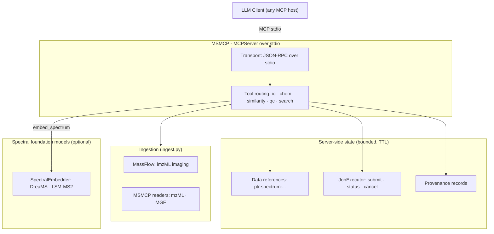

# MSMCP

**A Model Context Protocol server that turns mass spectrometry into a first-class tool for agentic AI workflows — without ever stuffing spectral data into a context window.**

MSMCP exposes exact-mass validation, adduct and isotope chemistry, spectral similarity scoring (classical *and* foundation-model embeddings), quality control, and asynchronous spectral library search to any LLM client that speaks the [Model Context Protocol](https://modelcontextprotocol.io).

Large acquisitions never enter the conversation: spectra are parsed into **server-side data references**, so an agent can hand a 100,000-peak spectrum to the next tool as a short `ptr:spectrum:…` string, with structured **provenance** attached to every derived result.

[](https://msmcp.dev)
[](https://www.python.org/)
[](https://docs.astral.sh/uv/)
[](LICENSE)

---

## Table of contents

1. [The problem: the Dark Metabolome meets the context window](#the-problem-the-dark-metabolome-meets-the-context-window)
2. [The solution: an MCP adapter with a data-reference store](#the-solution-an-mcp-adapter-with-a-data-reference-store)
3. [What you can ask it](#what-you-can-ask-it)
4. [Server-side data references](#server-side-data-references)
5. [How async dispatch solves execution timeouts](#how-async-dispatch-solves-execution-timeouts)
6. [Architecture](#architecture)
7. [Try it in 60 seconds](#try-it-in-60-seconds)
8. [Connecting an LLM client](#connecting-an-llm-client)
9. [An agent working through MSMCP](#an-agent-working-through-msmcp)
10. [Tool reference](#tool-reference)
11. [Instrument classes](#instrument-classes)
12. [Supported input formats](#supported-input-formats)
13. [Glossary](#glossary)
14. [Provenance](#provenance)
15. [Known limitations & roadmap](#known-limitations--roadmap)
16. [Security notes](#security-notes)
17. [Configuration reference](#configuration-reference)

For the full design — scope boundaries, layer rules, and the acceptance
criteria (v1.0 and v1.1) — see **[ARCHITECTURE.md](ARCHITECTURE.md)**. For
internals, testing, and the repository layout, see **[DEVELOPING.md](DEVELOPING.md)**.

---

## The problem: the Dark Metabolome meets the context window

Untargeted metabolomics is a data-volume problem wrapped around a chemistry problem. A single LC–MS/MS run produces thousands of spectra and **easily more than 100,000 peaks**; reference libraries contain **hundreds of thousands of spectra**. Even a 1M-token context window cannot hold one unfiltered run — and pasting raw peak lists into a prompt is the worst possible use of it: token burn, truncated spectra, and a standing invitation to hallucinate molecular identifications.

Worse, the chemistry itself is largely unknown. In untargeted studies, the overwhelming majority of detected features routinely lack confident structural annotation — the **Dark Metabolome**: the vast chemical space that instruments detect but reference databases do not yet name. Identifying anything in it demands:

- **Exact-mass rigor** — rejecting plausible-sounding but physically impossible proposals (ppm validation, isotope arithmetic);
- **Similarity at scale** — scanning huge libraries with classical peak matching *and* learned embeddings that generalise to spectra never seen before;
- **Statistically honest scoring** — FDR control rather than "looks similar" vibes.

All of that is deterministic, well-understood computation. **LLMs should reason about it; they should not perform it.**

## The solution: an MCP adapter with a data-reference store

MSMCP is a thin adapter between an LLM host and a stack of analytical engines:

- **Transport layer** — an [MCPServer](https://github.com/modelcontextprotocol/python-sdk) speaking JSON-RPC over stdio, launched as a child process by the LLM host. All diagnostics are logged to stderr; stdout carries only MCP framing.
- **Ingestion layer** (`src/msmcp/ingest.py`) — one dispatcher that picks the right reader for a file, and one canonical output type. [MassFlow](https://github.com/) is the canonical layer for everything it supports (imzML imaging data); MSMCP owns small readers for the formats MassFlow does not cover (mzML, MGF).
- **Analytical engines** — pure, deterministic, unit-tested Python modules under `src/msmcp/tools/` that perform the actual science: exact-mass arithmetic, adduct shifts, isotope annotation, ppm validation, cosine scoring, QC metrics, and chunked library scanning.
- **Data-reference store** (`src/msmcp/state/`) — a bounded, thread-safe registry of scientific payloads that stay on the server. This is what lets an agent hand a 100,000-peak spectrum to the next tool as a 30-character string.
- **Provenance** (`src/msmcp/provenance.py`) — immutable, structured records attached to every derived object: which operation, which parameters, which file (with reader backend and digest), which parent references, which software and model versions.
- **Model adapters** — a pluggable `SpectralEmbedder` interface (`src/msmcp/models/`) behind which spectral foundation models (DreaMS, LSM-MS2) plug in without touching the tool layer. Optional: core MSMCP never requires model weights.
- **Execution** (`src/msmcp/execution/`) — long-running work goes through a `JobExecutor` interface. v1.0 ships a local asyncio implementation; the server does not know or care whether the backend is a thread pool, a process pool or an orchestrator.

The server holds only bounded, TTL-limited state: registered data references and job records. The division of labour is explicit: **the LLM plans, the tools compute, the store remembers.**

## What you can ask it

MSMCP turns a conversation into an interface to your mass-spectrometry data. You
ask in plain language and the agent picks the tools; the questions it is built
for are these:

| Ask… | What happens | Tools it uses |
|---|---|---|
| "What's in this acquisition, and does it look healthy?" | Summarise a run, then score its quality | `load_mzml_summary`, `generate_qc_summary` |
| "Which MS2 spectra are in this run, and which should I search?" | An index of the run's spectra — index, MS level, retention time, precursor m/z, peak count — to choose a query | `list_spectra` |
| "Pull up the MS2 spectrum at index 12 and describe it." | Read one spectrum server-side and report its peaks | `load_spectrum`, `summarise_reference` |
| "I think this feature is caffeine — does the chemistry hold up?" | Check the adduct, isotope envelope and precursor mass error | `predict_adduct_offset`, `annotate_isotopes`, `validate_precursor` |
| "Is my measured precursor consistent with this formula?" | A ppm mass-error gate: pass or reject | `validate_precursor` |
| "How similar are these two spectra — and what is unexplained?" | Cosine similarity, plus the query peaks with no match | `compute_cosine` |
| "Search this spectrum against my spectral library." | A ranked, significance-scored hit table | `search_library`, `check_search_status` |

The point is not that the agent *knows* the chemistry. It is that every answer
comes from deterministic, unit-tested computation, and every answer carries
provenance you can trace back to the input file.

## Server-side data references

A **`DataReference`** is a compact, opaque handle to science that stays on the server:

```
ptr:spectrum:9f3c1a4e7b2d...
```

The flow is what keeps spectral data out of the context window:

```text
load_spectrum(file_path="run42.mzML", spectrum_index=0)
  -> {"reference": "ptr:spectrum:9f3c…", "n_peaks": 100000,
      "mz_range": [50.0, 2000.0], "tic": 1.7e9,
      "provenance": {"operation": "load_spectrum", …}}

search_library(spectrum_reference="ptr:spectrum:9f3c…",
               database_file="libraries/metabolomics.db")
  -> returns a job ID immediately; the peaks never left the server

release_reference(reference="ptr:spectrum:9f3c…")
  -> freed now instead of waiting for the retention period
```

The properties that make it safe to rely on:

- **Opaque and stable** — generated from `secrets.token_hex`. Never a Python `id()`, a memory address or a path. Stable for the reference's lifetime, never reused after release.
- **Metadata, never payload** — a reference describes its data (kind, shape, byte size, lifetime, provenance). Its serialised form cannot contain the peaks.
- **Immutable** — registration validates the payload against its kind and stores it with read-only buffers, so a caller that mutates its own array cannot change what a later tool reads.
- **Bounded** — `MSMCP_MAX_REFERENCES` (default 128) and `MSMCP_MAX_TOTAL_BYTES` (default 512 MiB) are enforced by **refusing** new registrations, never by evicting data someone still holds. A resource error must not become a wrong answer.
- **Expiring and releasable** — `MSMCP_REFERENCE_TTL_SECONDS` (default 3600; `0` disables) expires references lazily on access; `release_reference` frees them immediately and is idempotent.
- **Namespaced** — the store partitions references by namespace so one workflow cannot dereference another's data.

**What is not claimed:** MSMCP does not claim *zero-copy*. Registration takes one defensive copy to guarantee immutability, and PyArrow is not a dependency. The guarantee that is actually tested is that the payload is **never serialised through MCP/JSON** — which is the one that matters to an agent.

> **Migrating from the earlier “memory pointer” wording:** the job ID returned by `search_library` is an execution handle, not a data reference. Both remain: job IDs address *work in flight*, `DataReference`s address *data at rest*.

## How async dispatch solves execution timeouts

LLM hosts impose hard timeouts on tool calls — typically a minute or less. A library scan takes minutes. Naive synchronous tools therefore *guarantee* host-side timeouts.

MSMCP's dispatcher/poller split changes the failure model:

| Problem | The job executor's answer |
|---|---|
| Tool call exceeds the host timeout | `submit` returns in milliseconds; the scan continues on a worker thread via `asyncio.to_thread` |
| Server restarts mid-search | Job state is in-memory and is lost — the price of zero infrastructure (see [limitations](#known-limitations--roadmap)) |
| Too many concurrent searches | A bounded semaphore caps simultaneously running scans, so an eager agent cannot exhaust the CPU |
| Failure with no signal | Failed jobs carry the full exception traceback, retrievable by the poller |
| "Is it done yet?" | Status transitions (queued → running → completed/failed/cancelled) are queryable by job ID at any time |

Finished jobs are expired from the executor after a one-hour TTL, so a long-running server never accumulates unbounded state.

## Architecture



**Separation of concerns in one sentence:** the transport marshals requests, the ingestion layer picks a reader, the tool modules implement the analytical engines, the reference store owns data at rest, the executor owns work in flight, and provenance records how each result was produced — no layer reaches into another's internals.

## Try it in 60 seconds

Prerequisites: [uv](https://docs.astral.sh/uv/) and Python 3.13 (managed automatically via `.python-version`).

```bash
# 1. Clone and sync (creates the venv, installs runtime + dev dependencies)
git clone <repository-url> msmcp && cd msmcp
uv sync --extra dev

# 2. Launch the server on stdio, then connect a host (see the next section).
#    The remaining commands are the same local gate CI runs.
uv run msmcp        # start the MCP server (Ctrl-C to stop)
uv run ruff format --check .   # CI runs this first; `make lint` does too
uv run ruff check .
uv run mypy
uv run basedpyright
uv run pytest       # fast unit suite (the eval notebook is deselected)

# 3. Or run the whole pipeline — sync, format, lint, unit tests, eval notebook, repomix pack
make all
```

The repository ships a **synthetic worked example**, so you can see a real
library search without sourcing any data of your own:

- `examples/caffeine_library.msp` — a 5-compound MSP/NIST text library.
- `examples/caffeine_spectrum.mgf` — one MS2 spectrum whose peaks duplicate the
  caffeine record, so the top hit is deterministic.

These are fabricated demonstration spectra, not measured data: the example
exercises the search mechanics, not a chemical identification. (MGF libraries
are read too, through the same `LibraryProvider` interface.)

Connect your MCP host — Zed is already configured by this repository's
`.zed/settings.json`; for other hosts see [Connecting an LLM
client](#connecting-an-llm-client) — then ask the agent:

> Load `examples/caffeine_spectrum.mgf` and search it against
> `examples/caffeine_library.msp` with `instrument_class="orbitrap"`.

You should get a **REAL LIBRARY — READ FROM DISK** banner with caffeine ranked
first (the report also states the significance and the null model it used):

| Rank | Compound | Score  | Precursor m/z | Formula   |
|------|----------|--------|---------------|-----------|
| 1    | Caffeine | 1.0000 | 195.0877      | C8H10N4O2 |

`uv` is the canonical tool — every command runs through it:

| Task | Command |
|---|---|
| Sync environment | `uv sync --extra dev` |
| Format | `uv run ruff format .` |
| Lint | `uv run ruff format --check .` · `uv run ruff check .` · `uv run mypy` · `uv run basedpyright` |
| Test | `uv run pytest` |
| Evaluate end to end | `uv run pytest tests/test_eval_notebook.py -m eval -s -q` |
| Validate similarity (opt-in) | `make validate-similarity` (needs `MSMCP_VALIDATION_DATA`) |
| Run the server | `uv run msmcp` |

The `Makefile` wraps these into one pipeline: `make lint`, `make test`, `make eval`, and `make all` (sync → format → lint → unit tests → evaluation notebook → repomix pack). Every target depends on `install`, so `make all` works from a fresh clone without a separate sync step. `make test` deliberately omits the evaluation notebook — that is `make eval` — to keep the inner loop at a few seconds.

Re-run `uv sync --extra dev` after changing `pyproject.toml`. The optional `repomix` pack (Node-based) is run as `repomix --style xml --output repomix-output.xml`.

## Container image (pre-release packaging)

The repository includes a minimal `Dockerfile` for local packaging checks. It
uses the committed `uv.lock` with `uv sync --frozen`, keeps the server on its
stdio transport, and does not add a network service or runtime credentials:

```bash
docker build -t msmcp:local .
docker run --rm -i \
  -e MSMCP_ALLOWED_ROOT=/data \
  -v "$PWD/examples:/data:ro" \
  msmcp:local
```

This image is a reproducible container starting point, not a published release
or registry entry. Package publication, registry metadata, and release signing
remain separate work under issue #19.

## Scientific validation

MSMCP keeps its *scientific* claims, its software tests and its identification confidence as separate things, and documents the evidence for each:

- [`SCIENTIFIC_VALIDATION.md`](SCIENTIFIC_VALIDATION.md) — per capability: the claim, the evidence, the tolerances and their justification, and an explicit **VALIDATED / PARTIAL / NOT VALIDATED** status. Isotopes and mzML ingestion are validated against independent references; **similarity is PARTIAL**; **statistical significance/FDR is NOT VALIDATED**.
- [`VALIDATION_SIMILARITY.md`](VALIDATION_SIMILARITY.md) — one bounded experiment comparing MSMCP's scorer against `matchms` on a pinned MassBank release and measuring library recovery on held-out spectra, with its limitations stated plainly.

`make validate-similarity` runs that experiment **opt-in**: it needs the external dataset (`MSMCP_VALIDATION_DATA`) and supplies `matchms` for the one command, so neither the runtime nor the fast test suite depends on it. With no dataset it skips cleanly and downloads nothing.

## Connecting an LLM client

MSMCP is a child-process MCP server. Any host that supports stdio MCP servers can spawn it with `uv run msmcp` from the project root.

Example configuration for **Zed** (`.zed/settings.json`):

```json
{
  "context_servers": {
    "msmcp": {
      "command": "uv",
      "args": ["run", "msmcp"],
      "env": {}
    }
  }
}
```

`command`/`args` is the current Zed schema; the older nested `command: {path, args}` object is rewritten on load by Zed's 2025-11-25 settings migration.

## An agent working through MSMCP

```text
User:    "What's in run42/experiment.mzML? Then search it."

Agent:   load_spectrum(file_path="run42/experiment.mzML", spectrum_index=0)
  → {"reference": "ptr:spectrum:9f3c…", "format": "mzML",
     "n_peaks": 842, "mz_range": [50.0, 900.1], "tic": 4.1e7,
     "provenance": {"operation": "load_spectrum", …}}

Agent:   summarise_reference(reference="ptr:spectrum:9f3c…")
  → "Spectrum #0 | MS2 | RT: 2.00 min … Top 10 peaks …
     Provenance: load_spectrum … source: run42/experiment.mzML"

Agent:   search_library(spectrum_reference="ptr:spectrum:9f3c…",
                        database_file="libraries/metabolomics.db",
                        scoring_method="dreams")
  → "Job ID: 362c0267… (the peaks never entered the conversation)"

Agent:   check_search_status(job_id="362c0267…")
  → "🔄 Running — scanning the spectral library …"

Agent:   check_search_status(job_id="362c0267…")
  → "## Spectral Library Search Results …
     | Rank | Compound | Score | FDR (q-value) | Precursor m/z | Formula | …"

Agent:   validate_precursor(theoretical_mass=194.0804, experimental_mass=194.0831)
  → "VALIDATION REJECTED
     Mass error:        13.91 ppm
     Instrument class:  generic (precursor tolerance 5.0 ppm)
     … This is physically invalid for the hypothesised compound under the
     generic class assumption. Reconsider the molecular formula, adduct
     assignment, or instrument calibration."

Agent:   release_reference(reference="ptr:spectrum:9f3c…")
  → "Released. The stored peaks are no longer available."

Agent:   "The top hit is caffeine, but the precursor mass error (13.91 ppm)
         fails validation — likely a sodiated adduct. Let me check…"
```

The agent carries references, job IDs and verdicts — never spectra.

> **Note on this walkthrough:** the *query* spectrum is genuinely read from `experiment.mzML`. The **library** depends on the path: an MSP/NIST-style text library (`.msp`, `.msp.gz`) or an MGF library (`.mgf`, `.mgf.gz`) is read from disk through the same security boundary as the query, while a path with no reader (such as the `metabolomics.db` string above) falls back to a synthetic library of 500–5,000 spectra seeded from that string. Either way the dispatch reply and the final report carry a banner naming which library actually answered the query, ahead of any hit table. Treat the hits as scoring results, never as identifications. See *Known limitations & roadmap*.

## Tool reference

Fourteen tools are exposed to the model: compact Markdown (or a single sentence) for human/LLM reading, and a structured object where a data reference is involved.

| Tool | Module | Purpose |
|---|---|---|
| `ping` | `tools/system.py` | Diagnostic health check |
| `load_mzml_summary` | `tools/io.py` | First-*N*-spectra text summary of a local `.mzML` file |
| `list_spectra` | `tools/io.py` | Index of a file's spectra — index, MS level, retention time, precursor m/z and peak count — for choosing one to load or search (`ms_level`/`min_peaks` filters, capped by `max_spectra`) |
| `load_spectrum` | `tools/io.py` | Parse one spectrum from any supported format and register it server-side; returns a `DataReference` plus metadata and provenance |
| `summarise_reference` | `tools/io.py` | Read a referenced spectrum back from server memory (no file re-read) |
| `release_reference` | `tools/io.py` | Free a reference immediately rather than waiting for expiry |
| `predict_adduct_offset` | `tools/chem.py` | Exact mass shift for 14 canonical adducts |
| `annotate_isotopes` | `tools/chem.py` | Exact isotope envelope (M … M+n) from a formula or SMILES; `isotopologues` sets the depth, so a halogen-rich formula's M+4 is reachable |
| `validate_precursor` | `tools/similarity.py` | Mass-error gate at the instrument class's precursor tolerance (5.0 ppm for the default `generic` class) |
| `compute_cosine` | `tools/similarity.py` | Classical or real-embedding spectral similarity; each side may be inline peaks or a server-side reference (embeddings require real inference). The matching window comes from `ms2_tolerance`, or the instrument class when it is unset |
| `generate_qc_summary` | `tools/qc.py` | Truthful QC metrics (TIC, spectrum counts, peak density, estimated SNR) from a real file, using the instrument class's diagnostic-ion window and SNR bands |
| `search_library` | `tools/search.py` | Asynchronous library search (job executor; classical or real-embedding scoring). MSP/NIST text and MGF libraries are read from disk through the security boundary; unsupported formats use a labelled synthetic fallback. Significance uses a fitted decoy tail, but its q-floor can suppress hits at library scale; reports disclose the model and floor. The **query** is always real data.
| `check_search_status` | `tools/search.py` | Poll a dispatched search by job ID. The report is delivered once; later polls return a short digest, and `full_report=True` re-requests it |
| `cancel_search` | `tools/search.py` | Cancel a pending or running search job |

Only `cancel_search` and `release_reference` mutate server state, and both advertise that on the wire.

## Instrument classes

Several tools apply an experimental threshold: `validate_precursor`'s precursor
gate, `compute_cosine`'s and `search_library`'s m/z matching window,
`generate_qc_summary`'s diagnostic-ion window and SNR bands, and
`search_library`'s significance threshold and small-library floor. None of
these is a bare literal. Each is resolved from the `instrument_class` argument
(default `generic`), which names a documented profile in
`src/msmcp/instruments.py`:

| Class | Precursor gate | MS2 / diagnostic-ion window | SNR bands |
|---|---|---|---|
| `generic` (default) | 5.0 ppm | 0.02 Da | 5 / 20 |
| `orbitrap` | 5.0 ppm | 0.01 Da | 5 / 20 |
| `tof` | 15.0 ppm | 0.05 Da | 5 / 20 |
| `ion_trap` | 0.5 Da | 0.5 Da | 5 / 20 |
| `triple_quad` | 0.7 Da | 0.7 Da | 5 / 20 |

Accurate-mass classes express the precursor gate in ppm; unit-resolution
classes (`ion_trap`, `triple_quad`) use a Da window, because a ppm gate shrinks
below one nominal mass at a few kDa and is meaningless on an instrument that
cannot resolve fractions of a nominal mass. The FDR threshold (0.05) and the
small-library floor (2000) are shared across classes — they are properties of
the statistics, not of the mass analyser.

The class and the values actually applied are always stated in the result: in
the report body for `validate_precursor`, `compute_cosine` and
`generate_qc_summary`, and in `Provenance.parameters` for `search_library`. An
explicit `ms2_tolerance` on `compute_cosine` overrides the class default, and
the response says which source the window came from. These are documented
conventions, not measured acquisition parameters — MSMCP does not yet parse
instrument model, resolution or calibration from a file (see *Known
limitations & roadmap*) — so the class is the assumption a result was produced
under, stated rather than hidden.

## Supported input formats

The reader is chosen from the file extension; every reader produces the same spectrum type, so no tool needs to know the format.

| Format | Reader | Notes |
|---|---|---|
| `.mzML`, `.mzML.gz` | `msmcp.mzml` | dependency-free; zlib-compressed binary arrays supported |
| `.mgf`, `.mgf.gz` | `msmcp.mgf` | strict: an unparseable peak line raises rather than being skipped |
| `.imzML` (+ `.ibd`) | MassFlow | imaging data; pixel coordinates are preserved on each spectrum |
| `.raw`, `.d`, `.wiff`, `.mzXML` | — | recognised and refused, naming the vendor and suggesting MSConvert |

MassFlow is a required dependency, but the installed release (0.1.x) is an **imaging** framework: it reads imzML/zarr/HDF5 and exposes no mzML or MGF reader. MSMCP therefore routes exactly what MassFlow supports through MassFlow, and owns small readers for the rest. That is a documented consequence of the available library, not a preference.

Two MassFlow behaviours are worth knowing before debugging an unexpected directory or log line:

- Importing MassFlow's data manager **reconfigures the root logger to write to stdout**, which would corrupt the stdio JSON-RPC framing. `massflow_io` repoints those handlers at stderr on import, and a test asserts that no handler in the process targets stdout after a read.
- The same import **creates a `logs/` directory** in the working directory. That is library behaviour MSMCP cannot suppress; it is gitignored and documented rather than hidden.

MS-Numpress-compressed mzML arrays require the optional `pynumpress` package and raise a missing-dependency error without it.

## Glossary

Plain-language definitions of the terms this document uses. Everything here is
standard mass-spectrometry or MCP vocabulary; the list exists so a reader from
either side — chemistry or agent tooling — is not stopped by the other side's
jargon.

| Term | Meaning |
|---|---|
| **MCP** (Model Context Protocol) | An open protocol (JSON-RPC over stdio here) by which an LLM host launches and calls a tool server. |
| **Host / client** | The application driving the model and spawning the MCP server as a child process (e.g. Zed). |
| **Tool call** | One function the model invokes on the server, with typed arguments and a text result. |
| **Data reference** | An opaque token (`ptr:spectrum:…`) standing in for data held on the server, so spectra never enter the conversation. |
| **Job ID** | A handle for long-running work in flight; poll it with `check_search_status`. Distinct from a data reference (data at rest). |
| **Provenance** | The structured record attached to a result: operation, parameters, source file (with digest) and software versions. |
| **m/z** | Mass-to-charge ratio — the x-axis of a mass spectrum. |
| **MS1 / MS2** | A survey scan (all ions) / a fragmentation scan of a chosen precursor. Library search compares MS2 spectra. |
| **Precursor ion** | The ion selected for fragmentation in an MS2 scan. |
| **Adduct** | The ionised form of a molecule, e.g. `[M+H]+`, `[M+Na]+`; it shifts the observed m/z. |
| **Monoisotopic mass** | The mass using the most abundant isotope of each element (the M peak). |
| **M, M+1, M+2, …** | The isotope envelope: peaks one, two, … neutrons heavier than M. Annotated to M+2 by default; a halogen-rich formula carries its signal in M+2 and M+4. |
| **ppm error** | Mass error in parts per million; MSMCP's default precursor gate is 5.0 ppm (class-dependent). |
| **Cosine similarity** | A 0–1 score for how well two spectra's matched peaks agree; 1.0 means the matched peaks account for all intensity in both. |
| **Spectral library** | A collection of reference spectra to search against; MSMCP reads MSP/NIST-style text (`.msp`, `.msp.gz`). |
| **MSP / NIST text** | The plain-text interchange format most public libraries ship as. |
| **imzML** | An open format for mass-spectrometry **imaging** data; MSMCP reads it via MassFlow. |
| **p-value / q-value / FDR** | Significance of a hit, and the false-discovery-rate control across hits. |
| **Decoy** | A shuffled, non-matching spectrum used to estimate the false-positive background. |
| **Embedding / foundation model** | A learned vector representation of a spectrum; optional, and requires real model weights. |
| **Instrument class** | A named assumption set (orbitrap, tof, ion_trap, …) that supplies the default thresholds a scan applies. |
| **Allowed root** | The single directory subtree every file-reading tool is confined to. |

## Provenance

Every significant object MSMCP derives carries a structured, immutable provenance record:

```json
{
  "operation": "load_spectrum",
  "created_at": "2026-09-21T17:24:18.809783+00:00",
  "parameters": {"spectrum_index": 0, "source_format": "mzML", "reader_backend": "msmcp.mzml"},
  "sources": [{"path": "run42.mzML", "format": "mzML", "backend": "msmcp.mzml",
               "size_bytes": 84213, "digest": "sha256:5b1f…"}],
  "parents": ["ptr:spectrum:9f3c…"],
  "model": null,
  "software": {"name": "msmcp", "versions": {"python": "3.13.7", "msmcp": "1.0.0", "massflow": "0.1.2", "numpy": "2.3.4"}}
}
```

A search result can therefore answer, mechanically: which query reference, which file and which reader produced it, with which scoring method and parameters, under which software versions — and, for embedding-scored work, which model and checkpoint. Digests are computed for sources up to 64 MiB; larger files report `digest: null` rather than silently omitting the field.

It is deliberately not a provenance framework: no graph, no query language, no storage. Records travel with the objects they describe.

### Example: exact-mass chemistry

```text
LLM calls: predict_adduct_offset(adduct_string="[M+H]+")
→ "Adduct: [M+H]+
   Polarity: positive
   Charge state: +1
   Exact mass shift (Δ): +1.007276 Da
   m/z offset for neutral M: M + 1.007276 Da"

LLM calls: annotate_isotopes(identifier="C6H12O6")
→ "Monoisotopic mass: 180.0634 Da
   | M   | 180.0634 | 1.0000 |
   | M+1 | 181.0668 | 0.0686 |
   | M+2 | 182.0680 | 0.0143 |"

LLM calls: validate_precursor(theoretical_mass=180.0634, experimental_mass=180.0628)
→ "VALIDATION PASSED
   Mass error:        3.33 ppm
   Instrument class:  generic (precursor tolerance 5.0 ppm)"
```

The isotope envelope is the exact multinomial expansion of each element's
isotopes, not a first-order approximation.  That is what makes a halogen-rich
formula correct: chlorine and bromine have no single-neutron isotope, so their
signal sits in M+2 and M+4, and raising `isotopologues` reveals the M+4 peak a
C/H/N/O compound never has.

Hallucinated adducts (e.g. `[M+H2O]+`) are explicitly rejected with the list of supported ionisation pathways, rather than silently producing plausible-looking numbers.

SMILES → formula conversion uses RDKit when available (`uv sync --extra chem`); without it, `annotate_isotopes` falls back to a small static lookup table and asks the model to submit a formula instead of an unknown SMILES.

### Example: spectral similarity (classical → embeddings)

```text
LLM calls: compute_cosine(
    query_peaks=[[110.07, 40.0], [120.08, 100.0], [136.08, 60.0]],
    reference_peaks=[[110.07, 40.0], [120.08, 100.0], [136.08, 60.0], [500.10, 55.0]],
    scoring_method="dreams"
)
→ "Cosine Similarity (DreaMS): 0.8838
   Scoring method: DreaMS deep embedding (1024-d, L2-normalised)"
```

`scoring_method` accepts `"classical"` (greedy peak matching within a Da tolerance, with unmatched-peak reporting), `"dreams"`, or `"lsm-ms2"`. The embedding methods require real inference: if the corresponding model is unavailable in production, the tool raises `EmbeddingBackendUnavailable` rather than returning a value that looks learned. Embeddings matter for the Dark Metabolome: learned representations express *structural* similarity, so a spectrum with no library twin can still rank meaningfully against its nearest chemical neighbours — something raw peak alignment cannot do.

## Going deeper

Internals — the spectral foundation-model adapters (DreaMS, LSM-MS2, and the
test-only deterministic mocks), the `JobExecutor` interface, the testing and
linting story, and the full repository layout — live in
**[DEVELOPING.md](DEVELOPING.md)**, kept out of this document so it can stay the
user- and agent-facing story.

## Known limitations & roadmap

**Forward focus: local MS database connectivity.** Reading spectral libraries the user already has is under way: **MSP/NIST-style text and MGF** libraries are read from disk now, behind a `LibraryProvider` interface, alongside the acquisition readers. Still to come: a local SQLite peak store, so `search_library` covers the formats libraries ship as. MSMCP remains local, offline and self-contained: it ships no library data, downloads none, and never talks to a hosted service. See [ARCHITECTURE.md](ARCHITECTURE.md) → *Direction*.

- **Search names which library answered it**: the **query** spectrum is genuine data, read from disk through the ingestion layer or dereferenced from the store, so a missing or malformed query fails loudly before dispatch. A library path in a readable format (MSP/NIST text or MGF, `.msp`/`.msp.gz`/`.mgf`/`.mgf.gz`) is read from disk through the same `SecurityPolicy` as acquisitions — allowed root, size limit, read-only — and is refused with `PathEscapeError` if it resolves outside the allowed root. A path with no reader still falls back to a synthetic library, and the report says which path was used, in a banner ahead of any hit table. Still to come is the local SQLite peak store.
- **In-process job state**: jobs live in server memory and do not survive a restart; the poller reports a lost job as failed rather than pending. A durable executor is a drop-in `JobExecutor` implementation.
- **MCP Tasks are not dispatchable by the installed SDK**: the pinned `mcp` 2.1.1 ships the Tasks types but omits `tasks/get`, `tasks/result` and `tasks/cancel` from its request unions, so no server can answer them. The structural regression check in `tests/test_server_contract.py` is the readiness signal for #7; if it fails after an SDK upgrade, revisit the adapter before release. MSMCP keeps its snapshots in the MCP `Task` shape and exposes the semantics through `check_search_status` instead of inventing a protocol.
- **Readers MSMCP owns**: `.mzML`/`.mzML.gz` and `.mgf`/`.mgf.gz` are parsed by MSMCP itself, because the pinned MassFlow 0.1.x line is imaging-only. `.imzML` goes through MassFlow. Vendor formats are refused with conversion guidance. Revisit issue #10 when the installed MassFlow line exposes an mzML or MGF reader; the ingestion table and provenance backend must be updated together.
- **Model adapters — DreaMS real, LSM-MS2 blocked upstream**: `DreaMSInferenceEmbedder` runs real transformer inference behind the `SpectralEmbedder` interface (install the `dreams` package from source; weights auto-download). LSM-MS2 has no public weights wired into this repository; its bring-your-own-checkpoint adapter activates via `MSMCP_LSM_MS2_CKPT`. Backend resolution is governed by `MSMCP_EMBEDDING_BACKEND` (`real` / `mock`). Neither is required for core MSMCP to run or to be tested. Revisit issue #9 when upstream publishes usable inference weights.
- **Whole-slide images**: MassFlow materialises one placeholder per pixel when loading an imzML acquisition, so very large images are bounded by MassFlow's own behaviour.
- **MS-Numpress-compressed mzML arrays** need the optional `pynumpress` package and report a missing-dependency error without it.
- **Hardware control is out of scope for this repository, not just for v1.0.** Direct instrument control, actuation and the safety interlock layer that must precede them belong to a **different project**. MSMCP is a data and computation interface; the MCP application layer must never be the only barrier between a model and physical hardware. There is no instrument-control code here and none will be added.

See **[ARCHITECTURE.md](ARCHITECTURE.md)** for the full limitations list and the acceptance criteria (v1.0 and v1.1).

## Security notes

MSMCP is a **local, single-user server**: the MCP host spawns it as a child process with your credentials, so anything the server can do, a misused agent can do too. Keep these boundaries in mind:

- **Trust boundary** — anyone who can drive the LLM client can drive the server. Run it only on machines you own; it speaks stdio by design and must never be exposed as a network service.
- **File access** — every file-reading tool (`load_mzml_summary`, `load_spectrum`, `generate_qc_summary`, and both `search_library`'s query and its `database_file` library path) is confined to a single allowed root directory (`src/msmcp/security.py`). The default root is the server's working directory, override it with `MSMCP_ALLOWED_ROOT`. Paths that resolve outside that root — including symlinks that point outside it — are rejected with `PathEscapeError`, and for imzML the paired `.ibd` payload is checked against the same root. Files are also capped by a size limit (`MSMCP_MAX_FILE_SIZE_BYTES`, default 500 MiB) and a per-request spectrum-count limit (`MSMCP_MAX_SPECTRA`); for compressed input — a `.gz` file or a zlib-compressed mzML binary array — the size limit is enforced against the **inflated** bytes as they are read (`bounded_stream` in `src/msmcp/security.py`), so a small compressed file cannot expand past the budget. Access failures are reported truthfully and distinctly (`InaccessiblePathError` for missing/unreadable paths, `MalformedFileError` for unparseable data, `UnsupportedFormatError` for vendor formats, `MissingDependencyError` when an optional decoder is absent) rather than as a generic failure.
- **Server-side data** — registered references are bounded (`MSMCP_MAX_REFERENCES`, `MSMCP_MAX_TOTAL_BYTES`), expire after `MSMCP_REFERENCE_TTL_SECONDS` (default 3600), are held read-only, and are namespaced. Exceeding a limit refuses the request; it never silently discards data a caller still holds. Reference identifiers are opaque random tokens, never object ids, addresses or paths.
- **Execution** — concurrent jobs are capped by the executor (default 4). A cancelled job's partial output is discarded rather than returned.
- **Checkpoint loading** — the LSM-MS2 adapter deserialises a checkpoint file (`torch.jit.load`, falling back to `torch.load` with `weights_only=True`); checkpoint files can execute arbitrary code, so only point `MSMCP_LSM_MS2_CKPT` at files you trust. A checkpoint that needs full-pickle loading is **rejected unless `MSMCP_LSM_MS2_ALLOW_UNSAFE=1` explicitly opts in** — that fallback (`torch.load` without `weights_only`) can execute arbitrary code from the file. The DreaMS adapter downloads pre-trained weights from the upstream repository on first use — pin the `dreams` install to a commit you trust.
- **Dependency side effects** — importing MassFlow's data manager reconfigures the Python root logger to write to stdout and creates a `logs/` directory in the working directory. MSMCP neutralises the first (it would corrupt the stdio framing) and documents the second. See [Supported input formats](#supported-input-formats).
- **No secrets** — the server stores no credentials, requires no API keys, and makes no network calls of its own. This is a design constraint, not a current limitation: MSMCP is intended for onsite, offline use, so remote database adapters are explicitly out of scope (see [ARCHITECTURE.md](ARCHITECTURE.md) → *Out of scope*).

## Configuration reference

| Variable | Default | Effect |
|---|---|---|
| `MSMCP_ALLOWED_ROOT` | process working directory | Filesystem root every file-reading tool is confined to |
| `MSMCP_MAX_FILE_SIZE_BYTES` | 500 MiB | Per-file size ceiling |
| `MSMCP_MAX_SPECTRA` | 1000 | Spectra a single request may process (`generate_qc_summary` caps here and states the cap in its report) |
| `MSMCP_MAX_REFERENCES` | 128 | Live server-side data references |
| `MSMCP_MAX_TOTAL_BYTES` | 512 MiB | Summed payload size held by the reference store |
| `MSMCP_REFERENCE_TTL_SECONDS` | 3600 | Reference lifetime (`0` disables expiry) |
| `MSMCP_EMBEDDING_BACKEND` | `real` | `real` requires real inference; `mock` selects the test/dev-only stand-ins |
| `MSMCP_LSM_MS2_CKPT` | unset | Path to a bring-your-own LSM-MS2 checkpoint |
| `MSMCP_LSM_MS2_ALLOW_UNSAFE` | unset | `1` opts into full-pickle checkpoint loading (unsafe) |

Instrument-specific thresholds are deliberately **not** environment variables:
they are the per-call `instrument_class` argument described in
[Instrument classes](#instrument-classes), so the assumption behind a result
travels with the result rather than with the server's process environment.

---

*MIT License — Copyright (c) 2026 Eric Janusson.*
